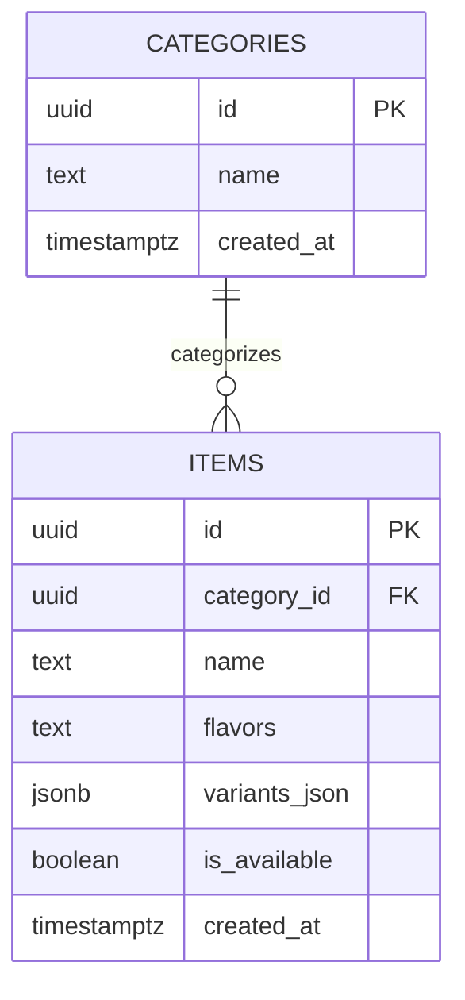

# Brew ni Cat Connect — Database Design

**Version:** 0.1 Draft
**Last updated:** 2026-10-18
**Status:** Phase 2 read-only catalog discovery and live public verification; no schema implementation or migration. RLS is currently manually disabled on the relevant catalog tables, which is a production security blocker.

## 1. Scope

This document records only the production catalog structures observed through existing POS source inspection and controlled read-only Supabase discovery for the Phase 2 public menu. It does not authorize schema changes, administrative access, customer data, ordering, inventory, sales, expenses, or POS synchronization.

No table, policy, function, trigger, migration, or production row was created, changed, or deleted by the application or automated follow-up. RLS was separately disabled on the relevant catalog tables before the live-menu follow-up.

## 2. Discovered Catalog Tables

### 2.1 `categories`

| Field | Observed role | Application use |
| --- | --- | --- |
| `id` | Category identifier | Joins items to a category; retained inside the typed catalog model and not displayed |
| `name` | Public category name | Category heading and category navigation label |
| `created_at` | Record creation timestamp | Not retrieved or displayed in Phase 2 |

### 2.2 `items`

| Field | Observed role | Application use |
| --- | --- | --- |
| `id` | Item identifier | Stable React/model identity; not displayed |
| `category_id` | Reference to `categories.id` | Groups each item under its category |
| `name` | Public item name | Menu item heading |
| `flavors` | Pipe-delimited flavor names | Split, trimmed, deduplicated, and mapped to a typed string list |
| `variants_json` | Variant definitions | Parsed defensively into variants, current prices, flavor-price overrides, and optional descriptions |
| `is_available` | Current availability flag | Mapped to `available`, `unavailable`, or `unknown` |
| `created_at` | Record creation timestamp | Not retrieved or displayed in Phase 2 |

## 3. Variant Shape

Observed entries inside `items.variants_json` use these application-relevant properties:

| Property | Meaning | Mapping rule |
| --- | --- | --- |
| `id` | Variant identifier | Kept as a non-displayed UI key; a deterministic local key is used only when absent |
| `name` | Size or variant label | Trimmed; invalid unnamed entries are omitted |
| `basePrice` | Current base price | Accepted only when finite and non-negative |
| `priceByFlavor` | Flavor-to-price object | Valid flavor names and finite non-negative prices become typed pairs |
| `description` | Optional variant/combo description | Trimmed and omitted when empty |

The database returns `variants_json` as structured JSON in normal Data API use; the mapper also accepts a JSON string so it can safely consume the representation found in the POS code and deterministic tests. Malformed values do not produce fabricated options or prices.

## 4. Relationships and Catalog Interpretation



The exact physical SQL types above are based on the existing POS TypeScript/schema use and should be confirmed from an approved migration/schema export before any future schema work. Phase 2 performs no migration.

- Six categories and sixteen items were observed during the initial privileged local read-only discovery; none of the sixteen was unavailable at that **BEFORE** observation time.
- The 2026-08-24 publishable-runtime follow-up independently returned the same current counts through public GET requests: 6 categories, 16 items, 0 unavailable items, and 0 unmatched item/category relationships.
- There is no discovered public menu view, catalog RPC, or explicit display-order field.
- Phase 2 therefore sorts valid category and item names alphabetically and documents that behavior rather than inventing a business order.
- Combos/packages are represented by ordinary items and variant descriptions rather than a separate public combo relation.
- Add-ons are hardcoded in the existing POS application, not stored in a discovered live Supabase catalog table. The public site does not present those constants as live database facts.

Counts are discovery evidence, not a permanent business promise. The current runtime response remains authoritative.

## 5. Public Access and RLS Observation

### 5.1 Before the live-menu follow-up

Initial read-only Data API probes using both locally available public credentials returned HTTP 200 and zero rows for `categories` and `items`. A controlled privileged read-only comparison confirmed that the production tables contained catalog rows. This **BEFORE** behavior was consistent with the then-existing RLS/API policy filtering anonymous access.

### 5.2 Current follow-up state

RLS was manually disabled on the relevant catalog tables. The application and verification process did not make that configuration change. With the same `NEXT_PUBLIC_SUPABASE_URL` and `NEXT_PUBLIC_SUPABASE_PUBLISHABLE_KEY` used by the browser runtime, public GET requests then returned the real 6-category/16-item catalog and the Menu rendered it without a privileged fallback.

This public access depends on table-level grants while RLS is disabled. It is not a least-privilege production design. HEAD-only/no-body checks also showed public reachability for `inventory`, `recipe_mappings`, `expenses`, `orders`, `order_items`, and `app_release`. Probes for `customers`, `sales`, and `payments` returned HTTP 404, which is ambiguous and is not proof of an authorization denial. No unrelated row body or business-data mutation was performed, and public writes were not tested.

Consequences:

1. the browser runtime continues to use only the public URL and publishable key;
2. Supabase remains the source of truth, and no poster-derived or privileged fallback data is present;
3. loading, empty, and recoverable error states remain valid application behavior and remain tested;
4. successful rendering is functional evidence, not least-privilege security evidence; and
5. before production, restore RLS and add/test explicit anonymous `SELECT` policies limited to intended catalog rows and fields while denying unrelated business tables.

**Update (2026-10-24):** RLS is back on for every public table, and guests can read only the menu and the POS releases. See §8.2.

## 6. Application Boundary

```text
Menu page
  -> typed catalog component
  -> fetchPublicMenu()
  -> public Supabase client
  -> SELECT categories + SELECT items
  -> defensive row-to-domain mapping
  -> customer-facing category/item/variant view
```

Queries are centralized under `src/lib/menu` and `src/lib/supabase`. JSX does not perform ad hoc table reads. CI and production builds do not need a live connection because retrieval begins at browser runtime; missing configuration produces a controlled public error state.

## 7. Deferred Design Work

Before Phase 3 or Phase 4 database work:

- approve and test the minimum public catalog read boundary;
- obtain a canonical schema/migration export and confirm physical types, constraints, indexes, and foreign-key behavior;
- decide whether categories need an explicit display-order and publication field;
- model add-ons only if approved requirements need live add-on data;
- separate public catalog availability from internal inventory data where necessary; and
- design order, customer, authentication, and RLS structures in an isolated environment before any production migration.

**Update (2026-10-24):** the order, customer and RLS structures were designed and tested on PGlite copies of the live schema before they went live. See §8.

## 8. Phase 4 Online Orders and Customer Data (2026-10-24)

Three migrations in `supabase/migrations/` add the data for Phase 4 (online orders) and Phase 5 (customer accounts). Each one has an undo file with the same name in `supabase/rollbacks/`. All three are applied to the live database and recorded in `supabase_migrations.schema_migrations`.

| Migration | What it does | Undo |
| --- | --- | --- |
| `20261024011051_restore_rls.sql` | Turns Row Level Security back on for every POS table and replaces the old policies | Turns RLS off on the POS tables again, as before. Use it only if the POS can't sync |
| `20261024064600_customer_tables.sql` | Adds the online order tables and the customer tables, all under RLS | Deletes those tables and every row in them. Run the functions undo first and export what the shop needs |
| `20261024064700_online_order_functions.sql` | Adds `place_online_order()`, `get_online_order()` and the status broadcast | Removes the functions. The order tables and their rows stay |

### 8.1 Rules for every new table

- Each table has RLS on, and the tables migration stops and undoes itself if any public table would still have RLS off.
- RLS decides which rows a role sees. Table grants decide which actions it may take. `anon` gets no table at all.
- Helpers live in the `private` schema, which the API doesn't expose: `private.is_staff()`, `private.stamp_row()` (sets `created_at` and `updated_at`) and `private.reject_loyalty_change()`.
- Timestamps are `timestamptz`. Money is `numeric(16, 2)` pesos, the same amounts the cart shows; the cart and the order functions both work in integer centavos underneath.

### 8.2 Row Level Security on the shared database

The POS and this site use one Supabase database. `20261024011051_restore_rls.sql` closes it again:

- Everyone can read `categories`, `items` and `app_release`. The site's menu and the POS update check read them with the publishable key.
- Everything else, and every change, needs a staff account: a signed-in user whose `app_metadata` has `"role": "staff"`. `private.is_staff()` reads `auth.users` on each call, so marking or unmarking an account works at once, without a new sign-in. Banned, deleted and anonymous users are never staff.
- Only SQL or the service role can change `app_metadata`, so a customer can't make themselves staff.
- The old policies pinned one account id. The migration drops every policy on the POS tables, so only the new ones apply.

### 8.3 Online order tables

| Table | Holds | Rules |
| --- | --- | --- |
| `online_orders` | One row per order: `reference` (`BNC-` plus six characters), `status`, `fulfillment`, `customer_name`, `customer_phone`, `notes`, `payment_preference`, `subtotal`, `item_count`, `rejection_reason`, `idempotency_key`, `realtime_topic`, `customer_id` and timestamps | `fulfillment` is `pickup` only. The phone is stored as `+639XXXXXXXXX`. A rejection reason is kept exactly when the status is `rejected`. `reference`, `idempotency_key` and `realtime_topic` are unique. `customer_id` becomes null when the account is deleted, so the order stays as a guest order (FR-043). Indexed by customer and date, and by status and date |
| `online_order_items` | The lines, copied from the menu when the order is placed: item and variant ids and names, flavor, unit price, quantity and line total | Up to 200 lines per order, numbered from 1. The line total must equal the unit price times the quantity. The copy keeps the order readable after the menu changes |
| `online_order_status_history` | Each status change: from, to, who made it (`customer`, `shop` or `system`), when, and a correlation id | The first row (no from status, to `pending`, by `customer`) is written with the order (FR-028). From and to must differ |
| `private.online_order_tokens` | The SHA-256 hash of each order's tracking token | Not reachable through the API. The token itself is never stored |

Statuses are `pending`, `accepted`, `rejected`, `preparing`, `ready`, `completed` and `cancelled`, as in `src/lib/orders/types.ts`. The allowed changes between them are left to the POS order screen (Phase 4, `TODO: Confirm with Brew ni Cat owner.`).

Who can read them: a signed-in customer reads their own orders, their lines and their history; staff read every order. Nobody can write them directly, staff included: orders are written only by `place_online_order()`, so the POS order screen needs its own function to change a status.

### 8.4 Customer tables (for Phase 5)

| Table | Holds | Who can use it |
| --- | --- | --- |
| `customer_profiles` | `user_id`, `full_name`, `phone` | The customer reads, adds and updates their own profile |
| `favorites` | `customer_id`, `item_id` | The customer reads, adds and removes their own favorites |
| `loyalty_transactions` | `customer_id`, `points` (never 0), `reason` (`order-completed`, `reward-redeemed` or `adjustment`), `order_id`, `note` | The customer reads their own rows. Rows can't be changed or deleted; a correction is a new `adjustment` row (FR-052, FR-056). One `order-completed` row per order at most |
| `data_requests` | `customer_id`, `kind` (`correction` or `deletion`), `message`, `status` | The customer reads and adds their own; staff read all and update the status (FR-042) |

Deleting an account removes its profile, favorites, loyalty rows and data requests, and keeps its orders without the account link.

### 8.5 Order functions

Both functions run as their owner (`security definer`, empty `search_path`), so the tables stay closed to the API and callers get only what the functions return (FR-037). They are the only functions these migrations open to the API.

`public.place_online_order(p_request jsonb, p_correlation_id uuid)` (FR-021, FR-022, FR-024, FR-025, FR-028):

1. Checks the request shape: an idempotency key (UUID), a tracking token (43 base64url characters), `pickup`, the customer details, at most 200 lines and the subtotal the customer saw. An empty cart is refused as `empty-cart`.
2. Returns the saved order if the idempotency key was used before, and saves nothing new.
3. Checks the name, phone and notes like the checkout form, and names each field that is wrong.
4. Prices every line from the live menu with the cart's rules (`src/lib/menu/map-menu-catalog.ts`, `src/lib/ordering/cart-pricing.ts` and `cart-reducer.ts`). It names each line it can't order. If the subtotal differs from the one the customer saw, it saves nothing and returns the new subtotal.
5. Saves the order, its lines, the token hash and the first `pending` history row in one transaction, with a new `BNC-` reference and a random Realtime topic.

It returns `{ ok: true, created, reference, status, createdAt }`, or `{ ok: false, reason }` with `invalid-request`, `empty-cart`, `invalid-details` (and `fieldErrors`), `line-unavailable` (and `lines`) or `price-changed` (and `subtotal`). Two requests with the same key at the same time save one order.

`public.get_online_order(p_reference text, p_tracking_token text)` returns one order for the order page: reference, status, fulfillment, name, payment preference, notes, lines, subtotal, item count, rejection reason, `createdAt`, the status history and the Realtime topic. It never returns the phone number or internal ids. A guest needs the reference and the tracking token; a signed-in customer reads their own orders; staff read every order (FR-044, FR-045, FR-046). Anything else returns `null`, so a wrong token and a missing order look the same.

### 8.6 Realtime status updates

After every status change on `online_orders`, a trigger sends a `status-changed` broadcast with `{ status, changedAt }` on the order's Realtime topic (`order:` plus 22 base64url characters). Only `get_online_order()` returns the topic, so only someone who can see the order can listen (FR-047). A failed broadcast is logged as a warning and never blocks the change; the order page also refreshes on its own (FR-048).

### 8.7 Applying migrations

Apply the files in name order, each exactly as committed, in one all-or-nothing request with its checks, then record it in `supabase_migrations.schema_migrations`. On 2026-10-24 each request also ran these checks before committing, and any failure rolled it all back:

1. **Before `restore_rls`:** mark the POS staff account as staff (`app_metadata.role = "staff"`), in the same request. Without it the POS stops syncing. Find the account inside SQL and never print or commit its id.
2. **After `restore_rls`:** check that staff can read and change the POS tables, that guests and a signed-in customer can read only the menu and the POS releases, and that nothing else is open.
3. **After the two order migrations:** in a step that is always undone, add a throwaway menu item, place an order as a guest, place it again with the same key, open it with and without its token, change its status as the shop would, and count the broadcasts. Then check RLS and what `anon`, `authenticated` and `service_role` can do.
4. Try each request on a PGlite copy first, then live with a forced rollback, and only then apply it.
5. **Before applying `online_order_status` (Phase 6):** in a step that is always undone, place a throwaway order, move it from pending to completed as the POS staff account (found inside SQL, never printed), check its POS sale and lines, check that a guest and a customer get SQLSTATE 42501, and check that `online_orders` is in `supabase_realtime`. Apply it only with the team's OK, since the shop's tablet starts receiving online orders.

To check what is applied, read `version` and `name` from `supabase_migrations.schema_migrations`. To undo, run the matching files in `supabase/rollbacks/` in reverse order, and delete their rows from `supabase_migrations.schema_migrations`.

If the POS shows a sync error after `restore_rls`, check that its account is still marked as staff and is signed in. Use the `restore_rls` undo only if that doesn't fix it, then apply the migration again before the site stays public.

### 8.8 Turning on Place order

Place order is off until the shop can see online orders. To turn it on, set `NEXT_PUBLIC_ONLINE_ORDERING=enabled` in the Vercel project and redeploy, after:

1. the POS order screen can see and update online orders (Phase 4), and
2. the order page at `/orders/[reference]` can open an order (Phase 4).

While it is off, pickup keeps the copy-summary flow and `POST /api/orders` answers 503. Set it back to empty and redeploy to turn it off again; placed orders stay.

### 8.9 Tests

`tests/database/` runs the migrations on PGlite, a WebAssembly build of Postgres, with a copy of the live POS tables (`tests/database/support/baseline.sql`), stand-ins for Supabase's roles, `auth.uid()`, `auth.users` and `realtime.send()`, and sample POS rows. They need no live database, so they run in CI with the unit tests (TC-P4-067 to TC-P4-093). The baseline also has the live `supabase_realtime` publication, and the Phase 6 status migration adds TC-P6-180 to TC-P6-190.

## 9. Phase 6 Online Order Status (2026-10-28)

Migration `20261028153552_online_order_status.sql` (undo: `supabase/rollbacks/20261028153552_online_order_status.sql`) lets the POS app move online orders through their statuses (FR-027, FR-028, FR-076). It logs every staff action (FR-079), turns each completed order into one POS sale (FR-075) and streams new orders to the POS (FR-080). It is not applied to the live database yet (§8.7).

### 9.1 Status steps

| From | To | Rule |
| --- | --- | --- |
| `pending` | `accepted` | |
| `pending` | `rejected` | Needs a reason of 1 to 300 characters, which the customer sees |
| `accepted` | `preparing` | |
| `preparing` | `ready` | |
| `ready` | `completed` | Adds the POS sale (§9.4) |
| `accepted`, `preparing`, `ready` | `cancelled` | For example when the customer never comes. An optional note goes only to the audit log |

Rejected, cancelled and completed are final. A pending order is rejected, not cancelled, so the customer always sees why.

### 9.2 `public.set_online_order_status(p_reference, p_from_status, p_to_status, p_reason, p_correlation_id)`

1. Runs as its owner with an empty `search_path`. Only `authenticated` can execute it, and it raises SQLSTATE 42501 unless the caller is staff (`private.is_staff()`).
2. Answers `invalid` for a malformed reference, an unknown status, a reason on a step other than rejecting or cancelling, or a reason over 300 characters. Reasons are trimmed.
3. Locks the order row. `p_from_status` is the status the staff member saw: if the order has moved on, nothing changes and the answer is `stale` with the current status.
4. Changes the status, adds a history row (actor `shop`, with the correlation id) and, on `completed`, adds the POS sale, all in one transaction. The trigger from §8.6 then updates the customer's order page.
5. A retry with the same correlation id and the same step answers `replayed: true` and changes nothing, so the tablet can resend after a lost answer.

It returns `{ ok: true, replayed, reference, status, changedAt, saleId? }`, or `{ ok: false, error, status? }` with `invalid`, `not_found`, `stale`, `not_allowed` or `reason_required`.

### 9.3 New tables

Both are in the `private` schema with RLS on, no policies and no API grants.

- `staff_audit_log`: one row per staff action, done or refused, with the staff account id, the action (`online-order-status`), the order reference, the result, details (from, to, the reason or error, the sale id) and the correlation id. The staff id stays out of the status history, which customers can read. Read it from the Supabase dashboard. How long to keep it is still to be confirmed with the owner (FR-079).
- `online_order_sales`: the POS sale id of each completed order. Its primary key makes sure an order is recorded once.

### 9.4 The POS sale

`private.record_online_sale()` adds one row to `public.orders` and one row per line to `public.order_items`, with the fields in system architecture §19.5. It never touches `inventory`: the tablet that completes the order deducts the stock (ADR-021). Rejected and cancelled orders make no sale.

### 9.5 Realtime

`public.online_orders` joins the `supabase_realtime` publication, only if the publication exists and the table isn't in it yet. Realtime applies the table's RLS policy, so staff get every order and a customer gets only their own.

### 9.6 Undo

The undo drops the function, its two helpers and the two tables, and takes `online_orders` out of the publication. The orders, their history and the POS sales stay; each sale still names its order in `table_label`. Applying the migration again carries on after the highest `online` sale id.

## 10. Live Website Content (2026-10-30)

Migration `20261030120000_site_content.sql` (undo: `supabase/rollbacks/20261030120000_site_content.sql`) moves the shop's facts out of the website's code (FR-085, FR-086, FR-087, ADR-017). Applied to the live database on 2026-10-31 (§8.7).

### 10.1 `public.site_content`

| Column | Type | Notes |
| --- | --- | --- |
| `section` | `text`, primary key | One of the nine sections below |
| `content` | `jsonb`, not null | The section's content, shaped as in `src/lib/site-content/types.ts` |
| `updated_at` | `timestamptz`, not null | Set on every save |

| Section | What it holds |
| --- | --- |
| `hours` | Each day's opening and closing time (`"HH:MM"`, 24-hour) or `null` for closed, and a note shown under the hours |
| `contact` | Phone number and email |
| `address` | Street, area, town, province, postal code, country, landmark and map link |
| `payments` | The accepted payment methods (1 to 6) and an optional GCash QR picture |
| `notice` | One line shown above every page; empty hides it |
| `social` | Facebook, Facebook photos and TikTok links; an empty link is hidden |
| `riders` | Up to 8 delivery partners, each with a name, a Facebook link and a logo |
| `about` | Opening date, page titles and text, the story, photos, menu summary, footer text and cat rules |
| `gallery` | 1 to 80 photos, each with optional `featured`, `landscape` and `people` flags |

Prices are not in this table. The home showcase "From" prices and the takeout box fee come from the menu (`categories`, `items`), which the POS already edits (FR-084).

### 10.2 Access

- RLS is on. `anon` and `authenticated` can read every row: the website reads with the publishable key (FR-037).
- Only staff (`private.is_staff()`) can change a row, and only its `content` column (column grant). Nobody can add or delete a section, rename one or set `updated_at` through the API; the nine rows come from the migration.
- "Only the owner" in FR-085 means the POS store account for now, since that is the staff account. An owner flag can narrow the policy later (security and privacy §14).

### 10.3 Rules

`private.check_site_content()` runs before each insert and update. It refuses content the website can't show with SQLSTATE 23514: a missing or unknown key, text with control characters or spaces at either end or over its limit, a time that isn't `"HH:MM"` or closes before it opens, a phone number without 7 to 15 digits, a link that isn't https, a picture outside `/images/`, an impossible date, or a list that is too long. The rules live in `private.is_valid_site_content(section, content)`. The website checks the same rules in `src/lib/site-content/validate.ts`, and `tests/database/site-content.test.ts` runs the same values through both.

### 10.4 Audit

`private.site_content_audit` gets one row per change: the time, the signed-in account (`auth.uid()`, empty for a change made from the dashboard), the action, the section, and the old and new content (FR-087). A save that changes nothing adds no row, and neither does a refused save. The table has no API grants at all; read it from the Supabase dashboard. Price changes in the POS are not audited yet; that comes with the POS work (ADR-017).

### 10.5 How the website reads it

- The pages are built once and refresh at most once a minute (`revalidate = 60`). Server reads use the publishable key with a 4-second limit, and only successful answers are kept, so an owner's change shows within about a minute with no redeploy.
- The website checks each section again. A missing, invalid or unreadable section shows the built-in copy (`src/lib/site-content/fallback-shop.ts` and `fallback-pages.ts`), and the server log names the section.
- When the menu can't be read, the home showcase hides its prices and the takeout box shows without a price.

### 10.6 Undo

The undo drops both tables, with their triggers, and the rule functions. The website goes back to its built-in copy. The saved content and its change history are deleted, so export them first if they are needed.

### 10.7 Tests

TC-P4-206 to TC-P4-212 run the migration and the undo on PGlite (`tests/database/site-content.test.ts`).

## 11. Product Icon and Image Columns (Phase 9 — 2026-10-31)

File: `supabase/migrations/20261031120000_item_icon_and_image.sql`. Undo: `supabase/rollbacks/20261031120000_item_icon_and_image.sql`. Covers the database schema for FR-093.

### 11.1 Columns added to `public.items`

| Column | Type | Purpose |
| --- | --- | --- |
| `icon` | `text`, nullable | Short POS icon key (`^[a-z0-9_]{1,40}$`, e.g. `coffee`, `cup_soda`, `leaf`, `milk`); `null` uses the built-in icon for the item or category |
| `image_url` | `text`, nullable | Product photo path under `/images/` (`.jpg`, `.jpeg`, `.png`, `.webp`, `.svg`, no `..` or `//`) or `https://` URL up to 500 characters; `null` uses the website's built-in photo mapping |

### 11.2 Constraints and access

- `items_icon_check` rejects empty strings, uppercase letters, spaces, hyphens and values longer than 40 characters (`SQLSTATE 23514`).
- `items_image_url_check` rejects empty strings, `http://` links, local paths outside `/images/`, path traversal (`..`), double slashes (`//`), unsupported local extensions, control characters and strings longer than 500 characters (`SQLSTATE 23514`).
- Table-level RLS and grants from `20261024011051_restore_rls.sql` apply unchanged: `anon` and `authenticated` can read both columns (`menu_readable_by_everyone`), and only staff (`private.is_staff()`) can insert or update them (`staff_full_access`).

### 11.3 Undo and tests

- `supabase/rollbacks/20261031120000_item_icon_and_image.sql` drops `items_image_url_check`, `items_icon_check`, `image_url` and `icon` from `public.items` without touching existing rows or prices.
- TC-P4-243 to TC-P4-247 run the migration, constraint checks, access checks and rollback on PGlite (`tests/database/item-icon-and-image.test.ts`).
