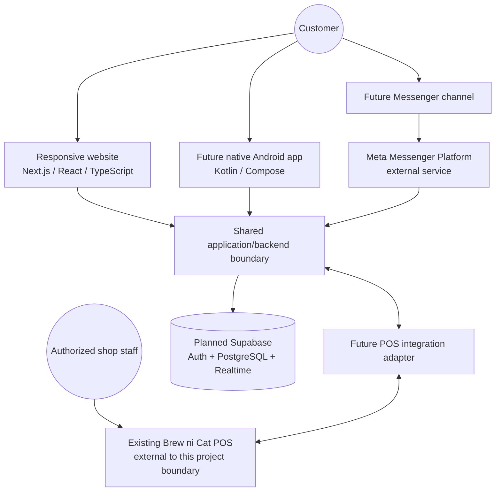
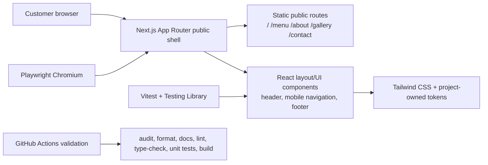
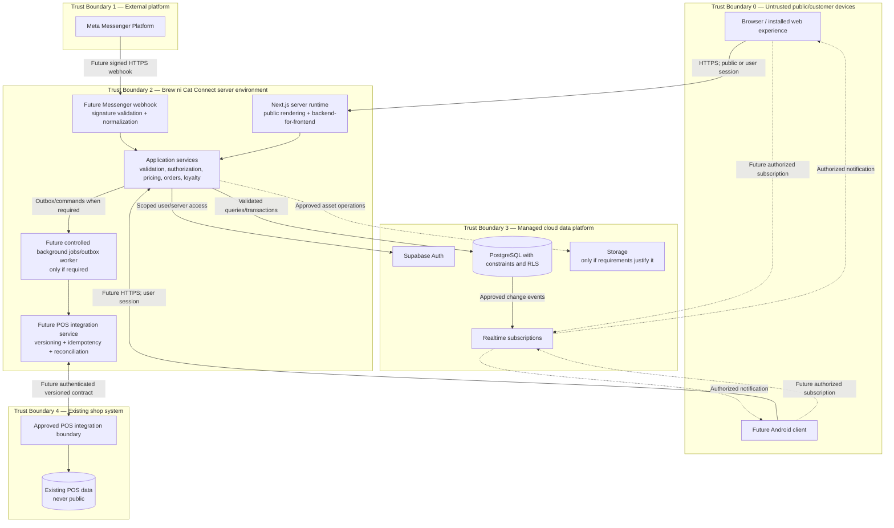
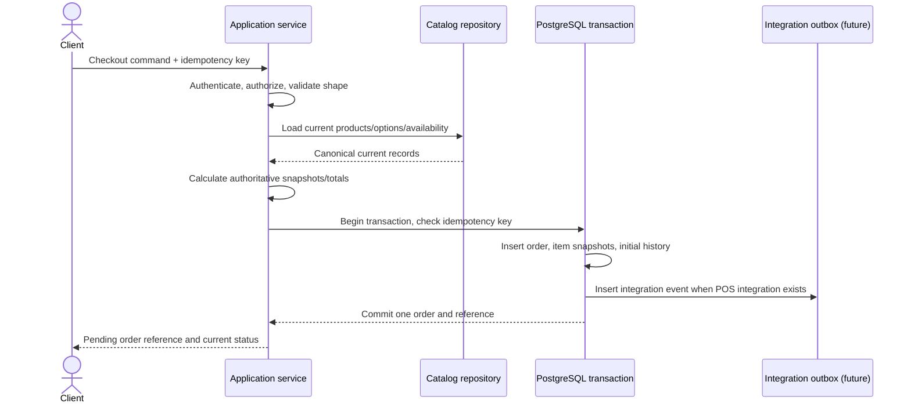
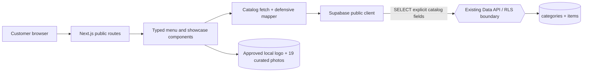
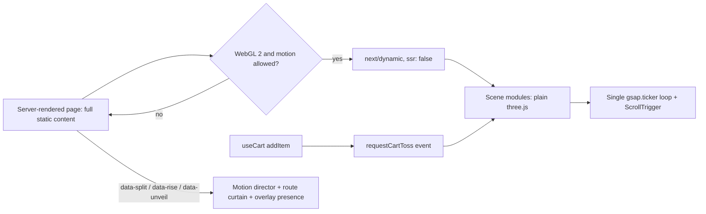

# Brew ni Cat Connect — System Architecture

**Version:** 0.1 Draft\
**Date:** 2026-10-18\
**Document status:** Living architecture baseline\
**Implementation status:** Phases 1 and 2 are merged; Phase 2 passed Renier's independent QA (PR #6). Phase 2 implements the public showcase and typed browser-runtime Supabase catalog reads; the publishable runtime renders 6 categories/16 items. Phase 3 adds client-side ordering (a `localStorage` cart, checkout and a copy-to-send order summary, with no server writes) and the three.js and GSAP experience layer (§18). RLS is manually disabled and unrelated business tables are publicly reachable, so production security hardening remains blocked. Server-side orders, customer data, authentication, realtime, Messenger, Android, and POS integration remain Planned or Deferred.

## 1. Architecture objective

Brew ni Cat Connect is a customer-facing omnichannel platform that complements the existing Brew ni Cat POS. Its website, future Android application, future Messenger assistant, and controlled POS integration should use a shared backend and one set of validated business rules. It is not a replacement or reimplementation of the POS.

The design prioritizes:

- mobile-first public and ordering experiences;
- one canonical customer-facing catalog/order/loyalty model;
- server-side validation for every business effect;
- least-privilege access and explicit trust boundaries;
- incremental delivery, beginning with documentation and a web foundation;
- replaceable, versioned integration boundaries; and
- accurate behavior under retries, partial failure, and offline conditions.

## 2. Context view



**Current reality:** Phase 2 retains the Phase 1 Next.js foundation and replaces placeholders with real Home, Menu, About, Gallery, and Contact routes. It adds approved local media, factual business configuration, and a typed read-only Supabase catalog adapter. The app has no authentication, customer/order data, write operation, ordering service, realtime, Messenger, Android, or POS synchronization. Current publishable catalog reads return and render 6 categories/16 items; loading, empty, and error states remain implemented/tested fallbacks.

### 2.1 Phase 1 as-built boundary



The only client-side state in this increment controls the accessible mobile navigation. The routes render development placeholders and confirmed project identity only. There are no effectful business operations, cookies introduced by application code, customer records, API routes, server actions, or external-service calls.

## 3. Proposed container and trust-boundary view



Arrows show logical data flow, not a final deployment topology. Direct client-to-Supabase access may be used for specifically approved operations only when RLS and policy tests enforce the same authorization guarantees. Privileged operations, external integrations, pricing, order creation, and loyalty mutation remain server-controlled.

## 4. Component responsibilities and status

| Component | Responsibility | Status in Version 0.1 |
|---|---|---|
| Next.js App Router web application | Public business content, responsive customer UI, route boundaries, later authenticated ordering screens | **Implemented through Phase 3** using Next.js 16.3.8; Phase 2 merged after Renier's independent QA (PR #6) |
| React component layer | Accessible, reusable presentation and interaction components | **Implemented through Phase 3:** shared shell, public sections, gallery, menu catalog/cards/states, factual routes, cart and checkout, and the 3D page wrappers (§18) |
| TypeScript types/configuration | Compile-time types for UI, configuration, catalog mapping, and later integration boundaries | **Implemented for the public UI and menu catalog boundary**; ordering/customer contracts remain later work |
| Tailwind CSS presentation layer | Project-owned design tokens, responsive layout, focus styles, and reduced-motion baseline | **Implemented** using Tailwind CSS 4.3.3; dark Night Shift Glow tokens since PR #23 (ADR-014); light Daylight Glass tokens with frosted glass panels since PR #68 (ADR-022); iOS 27 building blocks and a night theme with a day/night toggle since PR #71 (ADR-023, ADR-024) |
| Client cart and checkout (Phase 3) | Catalog-priced cart domain, persisted cart context, cart drawer/page, and checkout producing a send-to-shop order summary | **Implemented client-side** in PRs #7 and #14, with checkout field validation in `src/lib/ordering/validation.ts` (PR #20); server-side order creation and revalidation (FR-021, FR-024, FR-025) remain planned |
| Motion layer | `ScrollMotion` scroll hook, GSAP motion director, route curtain, overlay presence and the `template.tsx` page wrapper | **Implemented** in PR #16, refined in PRs #17 and #18, moved to GSAP in PR #23 (ADR-015, §18); off under reduced motion |
| Automated verification boundary | Component behavior, route smoke checks, representative-width overflow checks, type/lint/build gates | **Implemented:** Vitest/Testing Library, Playwright (`chromium` and `chromium-3d` projects, §18.3) and GitHub Actions; CI runs every check except Playwright |
| Backend-for-frontend/application service layer | Authenticate/authorize, validate requests, calculate authoritative outcomes, coordinate transactions, expose channel-neutral use cases | Proposed; interfaces evolve with requirements |
| Public Supabase catalog client | Read current approved categories/items through public configuration | **Implemented in Phase 2; live 6-category/16-item response verified** |
| Supabase Auth | Customer identity and session lifecycle | Selected for a later phase; sign-in methods and provider configuration remain undecided |
| PostgreSQL | Canonical customer-facing data, constraints, order snapshots/history, loyalty ledger | Planned for Phase 4; schema not yet approved |
| Row Level Security | Enforce least-privilege database access | **Current blocker:** RLS manually disabled; public table grants expose catalog and unrelated business relations. Restore/test intended-catalog-only policies before production |
| Realtime | Authorized order-status refresh notifications | Planned after canonical states exist |
| Messenger webhook | Verify Meta requests, normalize messages, invoke shared services, return policy-compliant responses | Deferred to Phase 7 |
| Conversational assistant | Grounded interpretation/discovery; never transaction authority | Candidate within Phase 7 subject to evaluation |
| Native Android client | Mobile UI consuming the same versioned backend contracts | Deferred to Phase 8 |
| POS integration adapter | Isolate legacy details, map versioned contracts, deduplicate, retry, and reconcile | Deferred to Phase 6 pending POS assessment |
| Background processing | Reliable asynchronous webhook/POS/event work where a requirement needs it | Not selected; add only with documented need |

## 5. Logical layers

The implementation should keep dependencies directed inward toward domain rules:

```text
Channel UI / Transport
        |
        v
Use cases / Application services
        |
        v
Domain rules and typed results
        |
        v
Ports (repositories, identity, messaging, POS)
        |
        v
Adapters (Supabase, Meta, POS, platform APIs)
```

- UI/routes translate user actions into use-case inputs and render typed outcomes.
- Application services coordinate authorization, validation, transactions, and idempotency.
- Domain modules contain testable calculations and state-transition rules without framework coupling.
- Ports describe capabilities; adapters contain provider-specific code.
- No channel owns a separate implementation of pricing, loyalty, or order-transition rules.

This is a proportional modular architecture, not a requirement to create independent microservices. A modular monolith is preferred initially to reduce operational complexity; deployment separation is introduced only for a measured scaling, isolation, or platform constraint.

## 6. Shared backend contract

All channels should ultimately invoke the same channel-neutral use cases:

| Domain capability | Web | Android | Messenger | POS adapter |
|---|---:|---:|---:|---:|
| Read published business/catalog data | Yes | Future | Future | Only as integration requires |
| Manage customer identity/profile | Later | Future | Account linking only if approved | No direct customer session |
| Build/validate cart | Phase 3 client-side cart (PRs #7, #14) | Future | Future guided draft | No |
| Submit an order idempotently | Later | Future | Future confirmed flow | Receives mapped online order |
| Read authorized order state | Later | Future | Future after secure linking | Supplies/receives approved state updates |
| Loyalty/favorites | Later | Future | Only if justified | Only approved integration data |

“Same backend” means shared domain rules, identifiers, and canonical records—not necessarily that every client receives identical endpoints or permissions. Channel-specific adapters may reshape presentation while preserving the same authorization and business invariants.

## 7. Data ownership and sources of truth

Version 0.1 distinguishes business stewardship, system of record, and integration authority. Final legal/controller roles and retention policies require confirmation.

| Data domain | Current / planned system of record | Authority/stewardship | Notes |
|---|---|---|---|
| Public business identity, location, variable-hours notice, and contact/social facts | Phase 2 typed site configuration sourced from the confirmed client brief; future maintenance UI/CMS remains undecided | Brew ni Cat | Publish only confirmed values; promotions and future maintenance workflow remain owner decisions |
| Customer authentication credential material | Supabase Auth when activated in Phase 4 | Authentication provider processes credentials under configured terms; business role requires privacy review | Application must never store plaintext passwords |
| Customer profile | Shared PostgreSQL backend | Customer supplies data; Brew ni Cat intended business steward, subject to confirmation | Collect only fields required by approved features |
| Product/category/public variants and flavors | Existing Supabase `categories` and `items` catalog, read-only in Phase 2 | Brew ni Cat | Publishable reads currently succeed; POS-hardcoded add-ons are not treated as live catalog data; avoid bidirectional edits |
| Published price and availability | Existing Supabase `items.variants_json` and `items.is_available`, read-only in Phase 2 | Brew ni Cat | Live browse values render; RLS-disabled exposure is not least privilege, and a later checkout server must still revalidate authoritative current values |
| Online order request and immutable item/price snapshot | Shared backend initially proposed | Brew ni Cat | POS receives through a controlled interface; final ownership depends on integration design |
| Acceptance and fulfillment status | Authority undecided pending shop/POS workflow analysis | Authorized shop process | Customer-visible backend state must reconcile rather than guess |
| Order status history/audit metadata | Shared backend plus required POS audit | Brew ni Cat | Append/history-oriented; retention to be defined |
| Loyalty ledger and balance | Shared backend proposed | Brew ni Cat | Ledger transactions are authoritative; clients display derived results |
| Messenger event identifiers/content | Minimum server-side records required for processing and policy | Platform/customer/business roles require privacy review | Define minimization and deletion/retention before launch |
| Operational logs | Hosting/database/integration logging stores | Brew ni Cat/project operator as documented | Redact secrets and unnecessary personal data; restrict access |

No POS field-level authority is assumed until the existing POS schema, business process, and failure modes are analyzed and recorded in an architecture decision.

## 8. Primary data flows

### 8.1 Public content/menu read

1. Browser requests a public route over HTTPS.
2. Next.js renders/cache-controls approved published data according to freshness needs.
3. The data layer returns public fields only.
4. Customer receives semantic HTML and progressive client behavior.

Failure: serve a usable error/empty state; never replace unknown business facts with generated content. Availability-sensitive records must not use a cache policy that hides critical changes beyond the approved threshold.

### 8.2 Authenticated customer operation

1. Customer establishes a session with the configured authentication flow.
2. Client sends a request with session proof and an idempotency key for effectful retryable operations.
3. Server validates input, authenticates identity, authorizes resource ownership/role, and invokes a domain use case.
4. Database constraints/RLS provide defense-in-depth.
5. A typed, minimal result returns; logs contain correlation metadata but no credential/secret.

### 8.3 Order creation transaction



The outbox is a proposed reliability pattern, not an implemented component. Payment behavior remains unspecified pending owner approval.

### 8.4 Status update/realtime

An authorized shop/POS workflow proposes a valid transition. The server checks the expected prior state and actor permission, records new state and history transactionally, then emits/permits an authorized refresh notification. Clients treat notification payloads as hints and fetch canonical state. Stale or invalid transitions do not overwrite newer state.

### 8.5 Messenger

Meta sends a signed event to a server-only webhook. The webhook verifies signature/freshness and deduplicates before invoking shared services. Any assistant is grounded in approved data and has an allowlisted action surface. Order-specific data requires an approved secure linking flow. Platform tokens and webhook secrets never enter client code.

### 8.6 POS synchronization

The integration adapter exchanges only a versioned, minimal contract. It maps stable identifiers, validates messages, deduplicates, retries safely, quarantines unmappable/conflicting records, and supports reconciliation. Neither browser, Android, nor Messenger connects directly to the POS or its database.

As built: the website and the POS app share one Supabase database, and online orders reach the POS through it (§19).

## 9. Authentication and authorization architecture

### 9.1 Authentication

- Supabase Auth is planned for customer identity after Phase 4 design.
- Exact sign-in methods, verification requirements, and account recovery policy are `TODO: Confirm with Brew ni Cat owner.`
- Secure, HTTP-only cookies are preferred where an applicable server-rendered web session design supports them; final session architecture must be documented before implementation.
- Android tokens use platform-protected storage when the app is introduced.
- Messenger platform identity is not automatically equivalent to a Brew ni Cat customer account.
- POS and other integrations use distinct non-human service identities, never customer credentials.

### 9.2 Authorization

- Deny by default.
- Customer may access only their own protected profile, orders, favorites, and loyalty records.
- Shop/staff permissions require a separately defined role model and administration boundary; no admin UI is assumed in Version 0.1.
- RLS protects direct database access paths; application checks protect use-case semantics and privileged operations.
- Service-role keys bypassing RLS stay server-only and are used narrowly.
- Authorization tests cover cross-account reads/writes and role escalation attempts.

## 10. Security and privacy boundaries

| Boundary crossing | Threats | Required controls |
|---|---|---|
| Customer device → web/application service | Tampering, injection, replay, credential abuse, automation | HTTPS, schema validation, server calculations, secure session, CSRF protection where applicable, rate limits, idempotency |
| Customer client → realtime service | Cross-account subscription, metadata leakage, stale events | Authenticated scoped topics/RLS, minimal payload, re-fetch canonical record |
| Meta → Messenger webhook | Forged request, replay, event flood, malicious text | Signature/freshness verification, idempotency, rate limit, schema validation, allowlisted actions |
| Application → Supabase | Excess privilege, secret exposure, SQL/data leak | Environment secrets, separated roles/projects, parameterized access, RLS, audited migrations, log redaction |
| Shared backend → POS adapter | Spoofed service, schema mismatch, duplicates, conflict | Mutual/strong service authentication as supported, versioned schema, stable IDs, idempotency, reconciliation, least privilege |
| Build/deployment → production | Supply-chain compromise, secret leak, unreviewed migration | Lockfile, dependency/license review, protected secrets, CI checks, reviewed migrations, controlled deployment/rollback |

Privacy architecture follows data minimization and purpose limitation. Retention, deletion, data-subject request handling, analytics, incident response, and vendor-processing details will be completed in the security/privacy and deployment phases with consideration for RA 10173. No production personal data belongs in development fixtures, screenshots, commits, or test output.

## 11. Reliability and failure architecture

- **Idempotency:** order creation, loyalty awards/redemptions, inbound webhook events, and POS messages need stable deduplication keys.
- **Transactions:** order + items + initial history and loyalty ledger mutations must preserve atomic invariants.
- **Retries:** use exponential backoff with bounded attempts and jitter; do not retry permanent validation/authorization errors.
- **Outbox/inbox:** use when reliable cross-system event delivery is introduced; do not make a database commit and remote call appear atomic.
- **Reconciliation:** compare shared-backend and POS states by stable identifiers; surface unresolved conflicts for authorized review.
- **Degraded mode:** public pages should remain usable when optional services fail; checkout clearly reports unconfirmed outcomes; realtime falls back to refetch/polling; conversational help falls back to deterministic navigation.
- **Observability:** structured logs, correlation IDs, metrics, and actionable alerts without secrets or unnecessary personal data.
- **Backup/recovery:** define Supabase/database backup availability, restore responsibility, recovery objectives, and restore testing before production.

Exact availability, recovery, performance, and retention targets belong in non-functional requirements and must be tested against realistic capacity.

## 12. Deployment and environment topology

The hosting provider for the Next.js runtime is not selected in Version 0.1. The logical environments are:

| Environment | Purpose | Data rule |
|---|---|---|
| Local development | Developer feedback and unit/component testing | Synthetic fixtures or data labeled `MOCK DATA — FOR DEVELOPMENT ONLY` |
| Test/preview | Integration, review, and automated checks | Isolated synthetic data; no production secrets |
| Production | Customer/business operation after approval | Confirmed business data and minimized customer data |

Each environment should have separate credentials and, where practical, separate backend projects/resources. `.env.example` documents variable names only. Secrets live in approved local/deployment secret stores, are scoped/rotated, and never committed.

Database schema changes use reviewed, version-controlled migrations with a forward/rollback or corrective plan appropriate to the change. Application releases must remain compatible across staged schema/client rollout.

## 13. Repository boundaries

The Phase 2 as-built structure extends the Phase 1 foundation only where the showcase and catalog boundary require it:

```text
src/
  app/                 # App Router layout, public routes, loading/error/not-found states
  components/
    layout/            # site header, mobile navigation, footer
    ui/                # narrow reusable presentation components
  config/              # typed site navigation/project configuration
tests/
  unit/                # Vitest + Testing Library component/page behavior
  e2e/                 # Playwright route, mobile-menu, 404, and width smoke tests
.github/workflows/      # lightweight pull-request/push validation
docs/                   # version-controlled specification and evidence
```

`src/lib/menu`, `src/lib/supabase`, `src/types`, and menu/public UI components now exist for the justified Phase 2 read boundary. Server ordering, customer-domain, mutation, authentication, and broad integration directories remain absent until an approved capability needs them.

Rules:

- Mark server-only modules and prevent import into client bundles.
- Keep provider SDK calls behind adapters rather than throughout UI components.
- Keep validation schemas close to their boundary and domain invariants in domain modules.
- Prefer feature cohesion over deeply generic abstractions.
- Do not add `android/`, Messenger, POS adapter, or database structure before its phase and architecture decision justify it.

## 14. Key architecture decisions and open questions

### Direction established in Version 0.1

1. Use Next.js App Router, React, and TypeScript for the web foundation.
2. Prefer an initial modular monolith over microservices.
3. Plan Supabase for PostgreSQL/auth/realtime, gated by schema, RLS, and privacy design.
4. Keep business rules in shared server/domain modules; clients are not transaction authorities.
5. Build native Android later with Kotlin/Compose against versioned shared contracts.
6. Integrate Messenger later only through a secured server-side webhook.
7. Isolate the existing POS behind an assessed, authenticated adapter; never expose its tables directly.

These decisions are recorded in [`decisions.md`](decisions.md) with context, alternatives, consequences, and status; later architecture changes must keep the records synchronized.

### Open questions

- Hosting/runtime and regional deployment choice for the Next.js application.
- Approved customer authentication methods and required profile data.
- Catalog, price, availability, order acceptance, and fulfillment sources of truth after POS assessment.
- Staff/admin access boundary and role model.
- Payment/pickup/cancellation/loyalty business policies.
- Delivery scope: `TODO: Confirm with Brew ni Cat owner.`
- Final realtime performance/freshness target and polling fallback limits after validating the preliminary NFR-004 target.
- Final backup/restore objectives and incident contacts after validating the preliminary NFR-009 targets.
- Messenger account linking, data retention, human handoff, and whether AI passes a documented value/risk evaluation.
- Android minimum API level, notification scope, and distribution process.

## 15. Architecture validation gates

Before each later phase begins:

1. Link scope to functional and non-functional requirement IDs.
2. Update the context/data-flow diagrams to match the intended increment.
3. Record consequential decisions and threat/privacy considerations.
4. Define typed/versioned interfaces and their ownership.
5. Add success, failure, authorization, retry, and rollback test cases.
6. Run lint, type checking, tests, and production build; record literal results.
7. Review database migrations/RLS/integration contracts where applicable.
8. Update development log and evidence without marking unexecuted work as tested.

The Phase 1 foundation is **Tested and merged**. Phase 2 showcase/catalog code is in **Testing / Review**; live public rows are **Implemented**, verified at five widths, and covered by passing final local follow-up gates plus both hosted workflows for evidence head `975561b`. Independent review remains pending. The current manually RLS-disabled exposure is a production security blocker. Every mutation, customer-data, backend, or additional-channel entry remains **Planned** or **Deferred** until implementation and evidence exist.

## 16. Requirements traceability

| Architecture concern | Functional requirements | Principal non-functional requirements |
|---|---|---|
| Public web and catalog presentation | FR-001–FR-016 | NFR-001, NFR-005, NFR-029–NFR-035 |
| Shared cart, ordering, and tracking services | FR-017–FR-030, FR-044–FR-049 | NFR-002–NFR-010, NFR-015, NFR-038 |
| Supabase authentication, customer data, and RLS | FR-031–FR-043 | NFR-013–NFR-019, NFR-023–NFR-027 |
| Loyalty domain and transaction boundary | FR-050–FR-057 | NFR-006, NFR-014–NFR-015, NFR-021, NFR-025, NFR-038 |
| Messenger webhook/assistant adapter | FR-058–FR-064 | NFR-018, NFR-022–NFR-028 |
| Android channel adapter | FR-065–FR-070 | NFR-019, NFR-025, NFR-028, NFR-036 |
| POS adapter, mapping, and reconciliation | FR-071–FR-081 | NFR-006, NFR-008, NFR-021–NFR-022, NFR-038 |
| Owner changes in the POS, live website content, mini-games, advertising | FR-082–FR-091 | NFR-008, NFR-021, NFR-029–NFR-030, NFR-034 |
| Theme script, toggle and 3D studio colors | FR-092 | NFR-029, NFR-034 |
| Cross-cutting transport, operations, and delivery | Applicable FRs above | NFR-011–NFR-012, NFR-017, NFR-020, NFR-037–NFR-040 |

## 17. Phase 2 As-built Catalog and Media Boundary



### 17.1 Runtime and build behavior

The Menu component begins retrieval after browser render. `getPublicSupabaseClient()` validates only the public URL and publishable-key variables, disables authentication persistence/refresh, and issues explicit `SELECT` projections for `categories` and `items`. `fetchPublicMenu()` centralizes the two reads; `mapMenuCatalog()` converts nullable/untrusted row shapes into immutable application types and rejects malformed names/prices/options.

Compilation, CI, and static route generation do not contact Supabase. Missing public variables throw a customer-safe configuration error consumed by the menu error state. API errors produce retry; a successful zero-row response produces the empty state. Neither path leaks raw error details.

2026-10-30 (PR #69): rendering a page now reads the saved site content and the menu prices on the server with the same publishable key; see §20. When the public variables are missing, as in the CI validation job, the build makes no Supabase request and uses the fallback copy.

### 17.2 Data ownership and source of truth

- Supabase is authoritative for current category, item, price, variant/flavor, optional combo-description, and availability fields.
- The old poster images are non-authoritative visual references and never feed structured price data.
- The existing POS was inspected as a schema reference only; Brew ni Cat Connect does not expose or modify POS tables.
- The application uses alphabetical category/item order because no database display-order field was discovered.
- POS-hardcoded add-ons are not represented as live public facts.

### 17.3 Access blocker and required change boundary

Initial public credential probes returned HTTP 200 and zero rows; a controlled privileged read-only comparison found six categories and sixteen items. That is retained as **BEFORE** evidence. After RLS was manually disabled, the website publishable identity returned the current 6-category/16-item catalog. The application/follow-up made no database, RLS, or business-data change.

The required production follow-up is to restore RLS and add a separately reviewed public view or explicit minimum-field/row `SELECT` policies. Verification must run as the anonymous/public role and prove that approved catalog fields are readable while internal/customer/business records and all writes remain denied. Current HEAD-only/no-body probes found unrelated business relations publicly reachable, and writes were not tested. The browser must never receive privileged credentials.

### 17.4 Media and privacy boundary

The official logo and 19 selected approved shop/customer images ship from `public/images`. Next.js Image supplies responsive sizing and optimization. Alternative text is generic and factual; it does not name customers or infer personal/sensitive attributes. The application does not add customer-recognition, analytics, upload, or external media-processing services.

## 18. WebGL Experience and Motion Layers (PR #23)



### 18.1 Modules

| Path | Role |
| --- | --- |
| `src/components/three/engine/` | Renderer setup (Neutral tone mapping since PR #70, before it ACES; sRGB; shadows) with per-canvas release, cached HDRI environment (a half-size file on phones) that retries after a failed download, procedural PBR texture generators, post-processing chain (render → bokeh → bloom → output → grain) with shader precompiling, shared frame loop, device quality (with a lighter phone tier) and reduced-motion checks, frame budget, and start gates (`whenNear`, `whenIdle`, `whenCurtainSettled`) |
| `src/components/three/scenes/` | One module per scene: home showcase, menu hero, add-to-cart toss, gallery ring, visit sign and street model, ambient page backdrops, state scenes (empty cart, order ready, not found), and the shared product models |
| `src/components/three/canvas/` | Client components that own a `<canvas>`, start and dispose a scene through `useScene`, and connect ScrollTrigger |
| `src/components/three/*.tsx` | Page-level wrappers with the static fallback: `HomeShowcase`, `MenuHero`, `CartFxLayer`, `GalleryRing`, `VisitStage`, `AmbientBackdrop`, `StateScene` |
| `src/components/motion/` | `MotionDirector` (entrances and scroll reveals by data attribute, run before paint on every route), `RouteCurtain` (title-card page transitions), `usePresence` (overlay enter and exit), `ScrollMotion` (header state and hero progress) |

### 18.2 3D per route

| Route | 3D | Static fallback |
| --- | --- | --- |
| `/` | Pinned scroll showcase: PET cup with real refraction, condensation and ice (Matcha, Cat-Feine), takoyaki, fries and Buldak Carbo, with floating ice, tea leaves, coffee beans and bonito flakes; visit sign and street model in "Find us in Kabacan" on a transparent full-bleed canvas, started as the visitor nears it | Five-item photo grid, plain sign type |
| `/menu` | Full-viewport hero: backlit "THE MENU" over turning cups with matcha-green and amber rim light and floating ice, beans and leaves that dolly and fade into the catalog on scroll; plain menu cards with the shop photo across the top; Add to Order throws the item photo into the header cart button (420 ms), which bumps, before the drawer opens | Plain hero heading and the same plain menu cards |
| `/gallery` | Ambient backdrop; curved, draggable ring of the 13 gallery photos without people, with prev/next buttons and a live caption | Full photo grid (always present) |
| `/contact` | Ambient backdrop; flip-able OPEN/CLOSED sign and street model (Pulido Eatery on the left, the small Brew ni Cat unit on its right) | Plain sign type |
| `/about` | Ambient backdrop behind the page heading | Plain heading background |
| `/cart`, `/checkout` | Ambient backdrop; an empty clear cup with drifting ice and beans for an empty cart; on checkout, the cup pouring full of matcha when the order summary is ready | Static icons |
| Not found | The empty cup tipped over on a shadowed floor in front of a backlit "404" | Large "404" type |

### 18.3 Rules

- Each feature uses its own WebGL canvas. The cart canvas (only on `/menu`) sits at 60, above the header, never takes pointer events and is hidden except during a toss. The order dialog and cart drawer sit at 70, the undo toast at 80 and the route curtain at 95.
- Layout is full-bleed: section backgrounds and 3D stages span the viewport; text and grids sit in `Container` (`--shell-max` 90rem of content plus `--shell-pad` fluid gutters). Cart and checkout split into form/items and summary columns from 900 px.
- On the home page the showcase stage starts under the translucent header (negative top margin equal to the header height) so the heading, actions and item controls fit in the first screen; a bottom scrim keeps that copy at AA contrast over the glows.
- Scenes pause when off screen or when the tab is hidden, release their WebGL context on unmount or when they fail part-way through starting, and compile their shaders before they show. Scenes far down a page start when they come within 800 px of the viewport; the cart toss starts when the browser is idle.
- Page transitions and frame pacing (PR #63): while the route curtain covers the page, the shared loop skips every scene's frame. The new page's hero scene (home showcase, menu hero, ambient backdrop) builds behind the curtain and holds it closed until it has drawn its first frame (`useCurtainHold`, 1.8 s at most), so the page opens with its 3D in place; other scenes start only after the curtain has fully opened (`whenCurtainSettled`). Every scene compiles its shaders and draws once out of sight (`warmUp`) before it shows; production renderers skip three.js's blocking shader error checks. The frame budget counts frames slower than 20 ms. When more than a quarter of a second's frames miss it steps down one stage at a time (first depth of field, bloom and half-size refraction, with slower shadows; then a pixel ratio of 0.75) and lets each stage settle before it measures again. A scene started later in the same visit begins at the stage earlier scenes reached. Desktop draws at a pixel ratio of at most 1.5 (1.75 before PR #63); `?quality=high` keeps every effect on. The first stage keeps the shadows and redraws them every third frame, because switching a light's shadow off rebuilds every lit material's shader. Shadow maps are drawn at most once a frame (`shadowPacer`), and a canvas drawn through post-processing doesn't multisample, since the effects' own target is already antialiased.
- The lite tier (ADR-014) goes to phones, integrated and software GPUs (by the GPU name the browser reports) and devices whose scenes were still too slow with every stage taken (remembered for 7 days); `?quality=high` and `?quality=lite` override it. Lite scenes draw straight to the canvas at a pixel ratio of 1 with no post-processing, shadow maps or refraction.
- On phones without `?quality=high` (the phone tier, ADR-014), the home showcase renders straight to the canvas at a pixel ratio of 1 with no post-processing or shadow maps, uses half-size generated maps, and shows clear plastic and ice as an additive gloss instead of refraction. Every phone scene lights with the half-size HDRI. On every device the showcase downloads the HDRI and the cup sticker while it builds the models, lets the page respond between its heavy steps, uploads its textures while the shaders compile, and starts the intro after two drawn frames.
- State scenes paint the color of the panel they sit on, with a soft studio light behind the clear cup, so the canvas edge disappears.
- Textures for photos load through the Next image optimizer (`/_next/image`), so no extra image copies ship.
- The motion director only touches elements marked with data attributes; it waits for the route curtain on client-side navigations and does nothing under reduced motion. A flag set before first paint holds animated content until the director takes over, with a 3 s CSS failsafe.
- Playwright runs functional journeys with reduced motion (static render) and a separate `chromium-3d` project with software WebGL for the 3D and motion checks; that project runs its tests one after another.

## 19. POS Integration As Built (FR-071)

Recorded on 2026-10-28 for PR #62, from the POS app repository (version 1.1.0) and a read-only look at the live database. It is the integration analysis FR-071 asks for before the POS order screen is built.

### 19.1 POS tables

The shop runs the POS app on one Android tablet. The app keeps the shop's data on the device and syncs it with these tables in the shared Supabase database:

| Table | What it holds | Who writes it |
| --- | --- | --- |
| `categories`, `items` | The menu, with sizes in `variants_json` and flavors | The POS app; the website only reads them |
| `inventory`, `recipe_mappings` | Stock counts, and how much stock each item size uses | The POS app |
| `orders`, `order_items` | POS sales and their lines | The POS app; from Phase 6 also completed online orders (§19.5) |
| `expenses` | Shop expenses | The POS app |
| `app_release` | Published POS builds | The team, by hand |

The website writes only its own tables (`online_orders`, `online_order_items`, `online_order_status_history`, `online_order_tracking` and the customer tables in the database design §8).

### 19.2 Sync and identifiers

- The tablet uploads its rows every 15 minutes (`SyncWorker`, WorkManager) with upserts. Its whole stock count replaces the cloud copy, so stock can only be changed on the tablet.
- A POS sale id is `device bucket × 1 000 000 000 + local id`, where the bucket comes from a hash of the device id. Ids stay below 1e15. A line id is `sale id × 1000 + line index`.
- The app also pulls sales saved under other device ids (the live data has some from earlier installs and test devices) and skips the ones it has, so a sale is never added twice. A pulled sale does not deduct stock again; the device that made it already did.
- The app also listens to `postgres_changes` on `orders` over Realtime, so a sale from another device shows at once. The 15-minute sync catches anything it missed.

### 19.3 Sign-in

The app signs in once with the POS staff account (Supabase Auth password sign-in), keeps the refresh token on the tablet and refreshes the access token before it expires. The account is marked staff in `app_metadata.role`, which the RLS policies check through `private.is_staff()` (database design §8.2). The app has no secret or service-role key (FR-037).

### 19.4 Releases

A new POS build is published by uploading the signed APK and adding a row to `app_release` (version code, version name, APK link, notes, mandatory). The tablet reads the newest row and, when its version code is higher than its own, downloads the APK and opens the Android installer. The steps are in the POS repository's `RELEASE_INSTRUCTIONS.md`.

### 19.5 Online orders in the POS (Phase 6)

- `public.online_orders` is in the `supabase_realtime` publication, so the tablet hears about new orders the way it hears about sales. Realtime applies the RLS policy, so only staff receive every order.
- Staff change an order only through `public.set_online_order_status()` (database design §9). The request names the status the staff member saw, so a retry or an out-of-date screen can't overwrite a newer status.
- Completing an order adds one POS sale in the same transaction (ADR-021). The tablet pulls it like a sale from another device, so it shows in the POS sales and reports.
- The tablet that completes the order deducts its stock, once per order reference, because the cloud stock count is replaced by the tablet's next upload.

Field map from a completed online order to its POS sale:

| POS field | Value |
| --- | --- |
| `orders.id` | From 2 000 000 000 000 001 up, above every POS id and below 2^53 |
| `device_id` | `online` |
| `timestamp` | When the order was completed, in epoch milliseconds |
| `subtotal`, `total` | The order's subtotal; `discount_deduction` 0 and `discount_label` empty |
| `payment_method` | `GCASH` when the customer chose GCash, otherwise `CASH` |
| `payment_reference`, `cashier_id` | Empty |
| `cashier_name` | `Online order` |
| `table_label` | `Online BNC-…` (the order reference) |
| `is_served`, `status`, `is_voided` | true, `COMPLETED`, false |
| `order_items.id` | Sale id × 1000 + line number |
| `item_id`, `item_name`, `variant_id`, `variant_name`, `flavor`, `quantity`, `unit_price`, `total_price` | The order line's item, size, flavor, quantity, unit price and line total |

### 19.6 What the integration does not do

- The website never connects to the tablet, and never writes the menu, stock, recipes, expenses or POS sales itself (FR-078).
- Online orders are not edited in the POS: staff accept, reject, prepare, finish or cancel them.
- An online sale is not voided or refunded from the website. If the shop voids it on the tablet, the POS handles it like any other sale.
- Rider and delivery orders are not in the system yet; the owner is still deciding.
- Ingredients used for an order cancelled after Preparing are not deducted; the staff adjust the stock by hand.

## 20. Live Website Content (PR #69)

The shop's facts are saved data, not page code (FR-085, FR-086, ADR-017). The table and its rules are in `docs/database-design.md` §10.

### 20.1 Read path

1. The root layout and the Home, About, Gallery and Contact pages call `getSiteContent()` (`src/lib/site-content/load.ts`), and the layout, Home and Contact call `getMenuFacts()` (`src/lib/menu/load-menu-facts.ts`). React's `cache()` makes each a single read per render.
2. Both use `getServerReadClient()` (`src/lib/supabase/server-read-client.ts`): the browser's publishable key, no session, a 4-second timeout, and Next.js keeps each successful answer for 60 seconds. The layout sets `revalidate = 60`, so pages stay static and an owner's change shows within about a minute with no redeploy.
3. Each section is checked by `parseSection()` (`src/lib/site-content/validate.ts`), the same rules the database enforces. A missing, broken or unreadable section falls back on its own to the copy in `src/lib/site-content/fallback-shop.ts` and `fallback-pages.ts`, with one server log line that names the section, never the content.
4. The layout passes the shop facts and menu prices to client components through `ShopFactsProvider` (`src/context/shop-facts-context.tsx`), so the cart, checkout, footer and 3D visit sign need no browser read of their own.
5. Menu prices outside the Menu page (the showcase's "From" prices and the takeout box) come from the live menu. While it can't be read, they are left out or described as priced by the shop, never guessed.

### 20.2 Write path

Staff accounts change the content in the POS web app (Stage 3) or, until then, in the Supabase dashboard. Every change is checked by the database and recorded in a private history table with who made it and the old and new content (FR-087). The website never writes this table.

### 20.3 Guard

`tests/unit/site-content-source.test.ts` (TC-P4-222) scans `src/` and fails when a price, an opening time, a phone number, an email, the address, a social link or a fixed payment or hours phrase is written in code outside the two fallback files.
